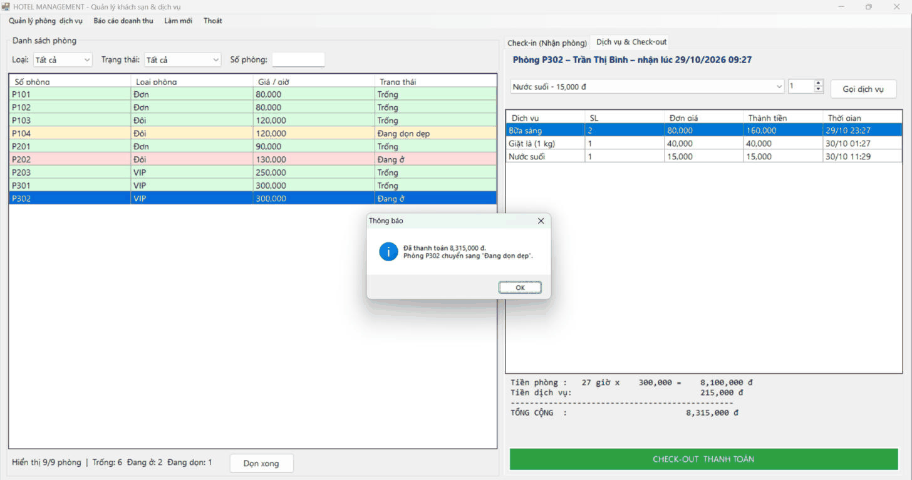
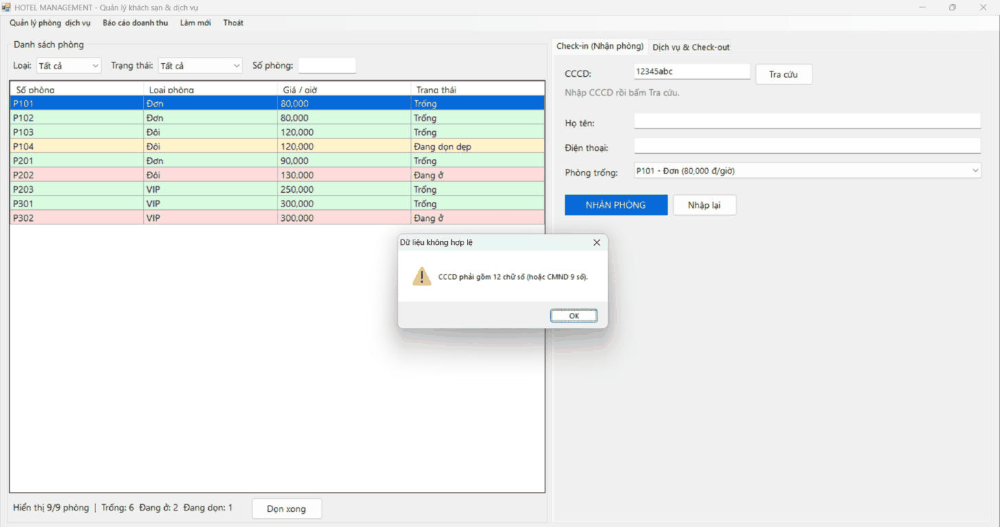

# BÀI TẬP 5.4 – HỆ THỐNG QUẢN LÝ TIỆN ÍCH DỊCH VỤ & KHÁCH SẠN (HOTEL MANAGEMENT SYSTEM)

Ứng dụng WinForms (C#, .NET Framework 4.8) kết nối SQL Server bằng ADO.NET, kiến trúc 3 lớp **DTO – DAL – BUS – GUI**.

## MỤC 1: THÔNG TIN SINH VIÊN

- **Họ và tên sinh viên:** Trần Nhật Đông
- **Mã sinh viên:** 24810320177
- **Lớp:** D19QTANM1
- **Tên Đề tài / Bài tập:** Bài 5.4 – Hệ thống quản lý tiện ích dịch vụ & khách sạn

## MỤC 2: HƯỚNG DẪN CÀI ĐẶT & CHẠY DỰ ÁN

**Yêu cầu:** Visual Studio 2022 (workload *.NET desktop development*), SQL Server + SSMS.

1. Mở SQL Server Management Studio (SSMS), chạy file `Database/ScriptDB.sql` để khởi tạo CSDL `HotelDB` và dữ liệu mẫu.
2. Mở file `HotelManagement.sln` bằng Visual Studio 2022.
3. Mở file `HotelManagement/App.config`, sửa `Data Source` trong chuỗi kết nối `HotelDB` cho phù hợp với máy cá nhân (ví dụ `.\SQLEXPRESS` hoặc `(localdb)\MSSQLLocalDB`).
4. Build & Run dự án (F5).

## Cấu trúc thư mục

```
├── Database/
│   └── ScriptDB.sql              # Tạo CSDL HotelDB (5 bảng) + dữ liệu mẫu
├── HotelManagement/
│   ├── DTO/                      # PhongDTO, KhachHangDTO, DichVuDTO (ServiceDTO), PhieuDatPhongDTO,
│   │                             # SuDungDichVuDTO, HoaDonThanhToanDTO
│   ├── DAL/                      # DatabaseHelper, PhongDAL, KhachHangDAL, DichVuDAL, PhieuDatPhongDAL
│   ├── BUS/                      # PhongBUS, KhachHangBUS, DichVuBUS, DatPhongBUS
│   ├── GUI/                      # FrmMain, FrmQuanLy, FrmBaoCao, UiHelper
│   ├── App.config
│   └── Program.cs
├── images/
├── README.md
└── HotelManagement.sln
```

## Chức năng đã thực hiện

| Yêu cầu đề bài | Cách thực hiện |
|---|---|
| Check-in | Tra cứu khách theo **CCCD bằng SqlParameter**. Khách mới thì nhập họ tên, SĐT. Chọn phòng trống → `PhieuDatPhongDAL.CheckIn()` trong **một SqlTransaction**: thêm khách (nếu mới) → lập phiếu → phòng sang *Đang ở* (có khóa `UPDLOCK` để 2 người không nhận trùng phòng) |
| Gọi dịch vụ | Chọn phòng *Đang ở* → chọn dịch vụ + số lượng; dữ liệu đi qua **SuDungDichVuDTO / DichVuDTO** từ GUI → BUS → DAL |
| Check-out & hóa đơn | Tổng tiền = **(số giờ ở × giá theo giờ) + tổng tiền dịch vụ**, số giờ làm tròn lên (tối thiểu 1 giờ). Xác nhận → `CheckOut()` trong **SqlTransaction**: lưu TongTienThanhToan, NgayTraPhong → phòng sang *Đang dọn dẹp*. Nút *Dọn xong* trả phòng về *Trống* |
| Lọc & tìm phòng ngắt kết nối | Danh sách phòng nạp 1 lần vào **DataTable**, lọc theo Loại phòng / Trạng thái / Số phòng bằng **DataView.RowFilter** ngay trên giao diện, không truy vấn lại CSDL. Các dòng tô màu theo trạng thái |
| CRUD | `FrmQuanLy`: Thêm / Sửa / Xóa phòng và dịch vụ, xem danh sách khách hàng; BUS kiểm tra dữ liệu (giá > 0, tên không trống, CCCD 12 số…) |
| Báo cáo | `FrmBaoCao`: lịch sử thanh toán theo ngày, doanh thu theo loại phòng, tổng doanh thu tính bằng **ExecuteScalar** |
| Chống SQL Injection | Mọi truy vấn đều dùng **SqlParameter** |

## MỤC 3: HÌNH ẢNH KẾT QUẢ CÁC MÀN HÌNH CHỨC NĂNG

1. Màn hình Chính / Tổng quan (danh sách phòng + lọc):
   
2. Màn hình Quản lý Danh mục / Thêm Sửa Xóa (CRUD):
   
3. Màn hình Thực thi Nghiệp vụ chính (Check-in / Gọi dịch vụ / Check-out):
   
4. Màn hình Báo cáo - Thống kê:
   
5. Minh họa xử lý lỗi (CCCD sai định dạng / nhận phòng không còn trống):
   
